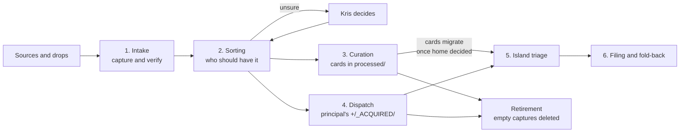

# Acquisition Process - proposed revision

**Status:** draft for Kris's approval through the [Enactment Process](</Users/krisbrown/kis/knowledge-islands/ki-principal/Admin/Operations/Processes/Enactment Process.md>). Nothing here changes the canonical note until Kris approves it.

**Owner:** Kris Brown · **Owning work:** `ki.prj.ways-of-working` · **Authority:** ACQUISITION-PROCESS-NOTE a, chosen by Kris on 1 November 2026 under ACQUIRE-ALL · **Target:** [Acquisition Process](</Users/krisbrown/kis/knowledge-islands/ki-principal/Pillars/Philosophy/Model/Processes/Acquisition Process/Acquisition Process.md>)

**Sources:** the `ki-acquire` skill as rechecked against Acquire on 1 November 2026 (harness `321742fe`); Acquire's README, AGENTS.md, CAPTURE.md and dispatch guide at Acquire `35647b8`; the owner decisions in Acquire intake's [decisions log](/Users/krisbrown/kis/personal/acquire/+/_WORK/personal.reg.acquire-intake/decisions.md) from ACQ020-MODEL (31 October) to SCAFFOLD (1 November); and HOLDING-SCOPE-CARDS, confirmed by Kris in Ways of working on 1 November 2026. Acquire's own text is the method's authority for now (ACQ020-OWNER, 31 October 2026).

## Change summary

1. **Staging graph added.** Acquire is now a port plus a knowledge-capture staging area: captures are curated into knowledge cards under `processed/<territory>/<island>/`, laid out like each island, with every territory principal scaffolded. The flow gains a Curation step between Sorting and Dispatch (ACQ020-MODEL, RESTRUCTURE, ISLAND-SHAPE-AND-MEETINGS, SCAFFOLD).
2. **Two ways out of Acquire.** Uncurated captures still leave whole by dispatch into `+/_ACQUIRED/`; curated cards migrate later, once their home is decided. How cards migrate is marked undecided, because the receiver-side compare and merge is not yet designed.
3. **Incremental curation replaces whole-capture retirement inside the port.** Each curated item leaves its capture in the curating commit, a dropped item in its own "considered and dropped" commit, and an empty capture is deleted (ACQ020-RETIRE). This is curation, not source retirement, and needs no further grant.
4. **Card rules.** One concept per card within a territory, the same card allowed in several territories, no link to a capture, and origin as one optional front-matter line (CARDS-NO-SOURCE-LINKS, CROSS-TERRITORY-COPIES, ORIGIN-FRONTMATTER).
5. **Meetings are sources, not cards.** Their concepts become cards, their record of who attended and the actions goes to `Calendar/`, their work to `Streams/` (MEETINGS-PROVENANCE, ISLAND-SHAPE-AND-MEETINGS).
6. **Future ideas** live in the graph as future concepts, not on a roadmap (ACQ020-FUTURE, IDEAS-IN-GRAPH).
7. **Lean capture.** Git's object hashes are the checksum for originals committed to Git; no `original.txt` or `SHA256SUMS` (CAPTURE-LEAN). The Harvest checkpoint and Provenance package sections say so.
8. **Temporary hold kept apart.** The holding position (dispatch on hold, backlog in `captures/_review/` worked back newest day first, cards held until the standards they must meet exist) sits in its own dated section, "Current holding position", released by Kris's word, so that the enduring lifecycle reads correctly once the hold lifts (GOAL-HOLDING-AREA, ACQ020-HISTORY, HOLDING-SCOPE-CARDS).
9. **Kept as it was:** the port and sorting-office framing, delivery is acceptance, no ledger, imperfect routing, provider-side source retirement undecided, drops and external source stores, the historical observations and the observed gap. ADR-KI-PRINCIPAL-001 needs no amendment: its stages still hold, with curation sitting inside Stage and harvest staying with the receiver.

Judgements for Kris to check when approving:

- HOLDING-SCOPE-CARDS is split: the tending and maturation of cards, with no rush, is written as enduring; "once they conform to the standards being built" and the reverse-date backlog are written as part of the temporary hold, because they depend on standards that do not yet exist.
- The diagram adds a Curation node and a "cards migrate" edge. The sibling `acquisition-flow.svg` and `acquisition-flow.workflow.json` are not linked from the note; the enactment should either regenerate them from the new diagram or delete them.
- Acquire's README still says cards are held "until each group's home is decided", without the standards condition; ACQ-HOLD-WORDING asks whether Acquire should add it. This draft follows Kris's fuller 1 November words either way.

The proposed text follows in full. Its links are written relative to the canonical note's folder, so they resolve once it is in place.

---

## Proposed text

````markdown
---
note_type: pillars/index
tags:
  - card/note
  - topic/knowledge-islands
  - topic/acquisition
status: current - November 2026
author: Written with Claude
---

# Acquisition Process

## Overview

The Acquisition Process is the operational picture of how material from AI sessions, meetings and other external sources enters the territory faithfully, is curated into knowledge, reaches the island that owns it, and eventually leaves its transient source. It applies [ADR-KI-PRINCIPAL-001](https://github.com/knowledgeislands/ki-principal/blob/d8ab8112/../Admin/Governance/Decisions/ADR-KI-PRINCIPAL-001-provider-neutral-knowledge-acquisition.md) to Acquire's model as Kris set it between 31 October and 1 November 2026. Earlier observations below remain historical evidence, not current storage requirements.

Acquisition is not session archiving. A source is visible because it holds transient working state; the destination is reviewed, durable island knowledge. Provider mechanics (MCPs, APIs, local parsers, export importers) sit below this boundary and belong to the repositories that own them. The `ki-acquire` skill in `ki-agentic-harness` carries the common capture and curation contract, and Acquire's own [README](https://github.com/krisb/acquire/blob/main/README.md), [repository instructions](https://github.com/krisb/acquire/blob/main/AGENTS.md) and [capture entry point](https://github.com/krisb/acquire/blob/main/CAPTURE.md) are its working authority for now.

The lifecycle below is the enduring model. Acquire is also, for the moment, a holding area with dispatch paused; [Current holding position](#current-holding-position) says what that changes and how it is released.

---

## End-to-end flow

Acquire is **the port**, with one entry per source, in the sense of [GDR-KI-PRINCIPAL-010](https://github.com/knowledgeislands/ki-principal/blob/d8ab8112/../Admin/Governance/Decisions/GDR-KI-PRINCIPAL-010-the-port.md). It acts as a **sorting office** and a **staging area**: material is captured in the private `acquire` repository, curated there into knowledge cards, and reaches the receiving principal either as whole capture packages or, later, as matured cards. "Harbour" is the port's [Arcadian](https://github.com/knowledgeislands/ki-principal/blob/d8ab8112/+/Realisation/Arcadia/Arcadia.md) register, the historical image of shipping between islands.



- **Sources and drops.** Material is born in a source: an AI session, a meeting, a message, a voice note or a photo. Where Acquire cannot read the source directly, Kris drops it in a holding place to wait for intake. A drop is not yet acquired.
- **1. Intake.** Acquire captures the material faithfully and verifies it. The committed capture package is the acquisition record; there is no separate ledger, checkpoint or intake receipt. A capture is a quick, transient dumping point, not lasting provenance.
- **2. Sorting.** Acquire decides only who should have each item: the territory and the receiving island. It does not decide what the matters are, where they will be filed or whether they change a decision. Anything unsure goes to Kris, and an unclear capture waits in `captures/_review/` rather than in an invented territory.
- **3. Curation.** Human judgement anchors curation into the staging graph under `processed/<territory>/<island>/`. Curation is incremental: each item leaves its capture as it becomes a card. See [Curation and the staging graph](#curation-and-the-staging-graph).
- **4. Dispatch.** On Kris's instruction, the port delivers whole capture packages into the receiving principal's `+/_ACQUIRED/` only. Delivery is acceptance: the receiver's commit adding the package and Acquire's commit removing it are the only delivery record.
- **5. Island triage.** The receiving principal decides what each delivered item is worth: file it, turn it into work or park it. Matured cards reach the island once their home is decided; how they are compared and merged with the island's own notes is not yet decided. Misdelivery is dealt with case by case; there is no return route to Acquire.
- **6. Filing and fold-back.** The receiving principal files what it keeps under its own Enactment Process and folds returning knowledge back into the notes it belongs to.
- **Retirement.** Inside the port, curation empties captures and an empty capture is deleted. After dispatch, Acquire removes its copy once the delivered package's committed tree has been verified against the source package. Neither authorises retiring the provider-side source.

Acquire holds the provider-free territory context that sorting needs. It is also where Kris reasons about material across territories, which is why it belongs to Personal. Routing context describes territories independently of the source provider.

---

## Curation and the staging graph

Acquire's `processed/<territory>/<island>/` is a knowledge-capture staging area, one island being one repository. It is neither a canonical knowledge graph nor the Knowledge Islands inbound and outbound staging mechanism. Under each island the layout follows that island's own shape, using its zone and folder names such as `Pillars/`, `Resources/`, `Streams/` and `Calendar/`, so a staged file's path says where it would land. Every territory principal has a scaffolded skeleton of its zones, each with a README saying what lands there; other islands get folders only when needed.

The cards form a maturing knowledge graph, the realisation of semantic Markdown, much like Zettelkasten index cards. Cards are tended and matured there with no rush to move them; a card moves on once its home is decided, which may be early where it is plainly an addition to existing knowledge. Acquire's entry points must work without its staged content, and no processed file ever stands in for an unprocessed capture.

- **Incremental curation.** Each curated item is deleted from its capture in the same commit that curates it into the graph. An item judged not worth keeping is deleted in its own commit, saying it was considered and dropped. A capture is deleted once it is empty. Git history keeps every deleted byte. This is curation inside the port, not source retirement: it leaves the provider untouched and needs no further grant.
- **One concept, one card.** A card defines its concept once within a territory and links to related cards rather than repeating definitions. The same card may also sit in another territory where it applies.
- **No link to a capture.** Captures are transient, so a card never links to one. A card has no origin section in its body; where its origin would help someone check it later, such as a named document or a titled conversation the body does not already cite, its front matter gives it in one plain line as `origin:`, for example "Discussed with Kris in conversation on 31 October 2026". Otherwise it has none.
- **Meetings are sources.** A meeting is not a node in the graph. Its decisions and concepts are curated into cards, its record of who attended and what the actions were is staged under the island's `Calendar/`, and its work under `Streams/`. The meeting may be named as a card's `origin:` where that adds value, and its capture then retires like any other.
- **Future ideas.** An idea that is not being enacted now goes into the graph as a future concept, kept distinct from what is being done, and not onto a roadmap. Only an idea being enacted now becomes work.

Uncurated captures still leave Acquire whole by dispatch; curation is not a precondition of delivery.

---

## Lifecycle stages

The ADR fixes six stages. Each has an owner for its mechanics; the receiving island owns acceptance of anything it keeps.

| Stage | What happens | Mechanics owner |
| --- | --- | --- |
| Discover | A content-minimised listing exists at source | Provider MCP or adapter |
| Acquire | Faithful read of the original, before interpretation | Provider MCP or adapter |
| Stage | Preserve the capture outside the receiving island and curate it into staging cards | Acquire |
| Harvest | Reconcile delivered packages and matured cards into the island | Receiving island |
| Durable knowledge | Accepted notes in canonical zones | Receiving island, under its Enactment Process |
| Archive or delete source | Retire the staged copy or the provider-side source | See [Source retirement](#source-retirement) |

Reusable provider-facing skills and paired adapter surfaces belong to `ki-agentic-harness`.

---

## Current holding position

This section records a temporary position, not part of the lifecycle. Kris set it in Acquire on 31 October 2026 (GOAL-HOLDING-AREA, ACQ020-HISTORY) and refined it on 1 November 2026 (HOLDING-SCOPE-CARDS). It lasts until Kris releases it.

- **Acquire is a holding area.** Dispatch is on hold, with Acquire's route-review and dispatch-backlog roadmap work (PERSONAL-ACQUIRE-018 and PERSONAL-ACQUIRE-019) paused. Nothing is delivered to `+/_ACQUIRED/` meanwhile.
- **Backlog.** Captures older than 31 October 2026 are held in `captures/_review/` and worked back one day at a time, newest first, without bulk moves to classify them. Working in reverse date order shows where one card supersedes another.
- **Cards stay.** Cards migrate into the islands once they conform to the standards being built for knowledge cards and the islands' graphs; until then they are kept and grown in Acquire's graph. A card whose home is plainly decided may still move earlier.

When the hold lifts, the [End-to-end flow](#end-to-end-flow) applies unchanged.

---

## Evidence

Current mechanics are defined by Acquire's [capture entry point](https://github.com/krisb/acquire/blob/main/CAPTURE.md), [README](https://github.com/krisb/acquire/blob/main/README.md), [repository instructions](https://github.com/krisb/acquire/blob/main/AGENTS.md) and [dispatch guide](https://github.com/krisb/acquire/blob/main/docs/guides/operator/dispatch.md), with the common contract in the `ki-acquire` skill. Acquire keeps no ledger or intake receipts. The committed package records acquisition, the curating and dropping commits record curation, and the receiver's addition commit with Acquire's removal commit records delivery.

### Historical observations before 20 October 2026

The two observations below explain the earlier staging model. The Granola ledger and migration manifest are historical evidence retained in Acquire's Git history at `aeb1ec4`, not live files to recreate. The former per-island staging location was retired on 10 October; the separate ledger and intake receipts were removed on 20 October.

**Export or API source: Granola, staged in the private `acquire` repository.** Since 2026-10-10 every Granola capture lands in `acquire` (`krisb/acquire`), consolidated from the inbound areas of the former per-island Ports.

- `.acquire/granola/ledger.json` (schema 3) records adapter, provider, hashed account identity, source-schema and identity-checkpoint SHA-256 values, the acquisition interval, `exhaustive`, per-window counts with response hashes, and per meeting the `document_sha256`, `detail_sha256`, `transcript_sha256`, transcript state, versions, folder ids, `acquired_at` and a harvest `disposition`.
- `.acquire/granola/migration/2026-10-10/manifest.json` proves the consolidation: the chosen source projection and hashes are retained exactly, historical memberships are kept, and a migration never fabricates source hashes.
- Each capture is a folder `captures/<territory>/granola/<date>--<slug>--<source_id>/` with `meeting.md`, `routing.json` and `source-variants/`. For example, `captures/humans-not-robots/granola/2026-06-24--hnr-company-fortnightly-update-in-teams--424a17fe-e8cc-4680-87df-a3db8f6eac72/`: its `meeting.md` carries `source_id`, `acquired_at`, `source_account_sha256`, `detail_sha256`, `transcript_state`, `transcript_sha256`, `transcript_observed_at`, folder membership and an explicit `omissions` list; `routing.json` records the primary repository, territories, disposition and original memberships.

**Direct local source: Claude Code sessions, via `mcp-housekeeping-claude` at read level.** `claude_code_sessions_discover`, `claude_code_sessions_list`, `claude_code_sessions_checkpoint` and `claude_code_session_read` are read-only. The checkpoint is content-minimised and writes nothing; per session it returns `id`, `sourceLocator`, `createdAt` (always null), `updatedAt`, `byteSize`, `status`, `archived` and `descendantIds`, under `schema`, `provider`, `repository` and `generatedAt`. The README in the `mcp-housekeeping-claude` repository is the tool catalogue.

---

## Provenance package

The ADR requires every adapter to preserve the fields below. This table records the earlier Granola and Claude Code observations, before the 20 October simplification; ledger references describe historical evidence, not a current requirement. Today a capture committed to Git relies on Git's object hashes as its content hash and keeps no separate checksum file; an original held outside Git keeps a recorded locator and hash.

| Required | Granola (staged capture) | Claude Code (checkpoint and read) |
| --- | --- | --- |
| Original content | Yes: `meeting.md`, plus `source-variants/` snapshots | Via `claude_code_session_read` (a preview, head and tail); not staged |
| Source identity | `source_id`, hashed account identity | Session `id` and `sourceLocator` |
| Timestamps | `acquired_at`, `transcript_observed_at`, `meeting_date`; source `created_at` and `updated_at` declared omitted | `updatedAt` only; `createdAt` is null |
| Assets | `attachments`, `audio` and `recording` declared omitted | Not evidenced |
| Provenance | Ledger, account and schema hashes, `routing.json` | `provider`, `repository`, `generatedAt` |
| Declared omissions | Explicit `omissions` list per capture | Content is omitted by design at checkpoint level; no per-session omissions list |
| Content hash | `document_sha256`, `detail_sha256`, `transcript_sha256` | Absent (`byteSize` only) |
| Repository context | `routing.json` and the territory folder | `repository` field |

Absence is stated, not hidden: the Claude path has no content hash and no creation time, and nothing is staged. Whether those gaps are closed by the harness work is for that work to decide.

Capture provenance is technical and transient. The provenance that lasts lives in the graph itself, as a card's plain-words `origin:` line where that helps someone check it later.

---

## Harvest checkpoint

A capture is safe to curate or dispatch when its committed package, as observed, holds:

1. Source identity and the account it came from.
2. Timestamps for acquisition and, where the source offers them, observation.
3. A content hash for each retained original: Git's object hash for an original committed to Git, or a recorded locator and hash for one held outside Git.
4. A declared list of omissions.

The historical Granola ledger met this per meeting and kept a harvest `disposition` (for example `staged`). Current capture evidence belongs with the committed package; no separate ledger is required.

---

## Imperfect routing

Initial routing may be wrong and need not be perfect. Before dispatch, a whole package can move within Acquire, or a whole copy be kept under a second territory, without rewriting its source evidence; consolidation happens at dispatch. The receiving island decides what it keeps; delivery grants no authority to accept canonical knowledge. After delivery, misrouting is dealt with case by case, without an automatic return route.

---

## Source retirement

Inside the port, incremental curation deletes items from captures and deletes a capture once it is empty, as [Curation and the staging graph](#curation-and-the-staging-graph) sets out; Git history keeps every byte, and history is never compacted.

After dispatch, Acquire removes its copy only once it has verified the receiver's committed package against the source package. The receiver's addition commit and Acquire's removal commit record the delivery. It does not wait for the receiving island's later filing or canonical decisions.

Archiving or deleting a provider-side source session remains **undecided**. Capture, curation, dispatch or harvesting alone does not authorise mutating that source. Any later provider-specific safety decision belongs to the owning repository.

A downloaded drop, such as an attachments ZIP in a holding area, is removed only when every item has been verified at its destination. Originals committed to Git must also be pushed and verified there before the drop is removed, as Acquire's [ChatGPT drop procedure](https://github.com/krisb/acquire/blob/main/docs/guides/operator/chatgpt.md#zip-fallback-for-originals) describes. Partial or held drops stay.

Images stay in Git. Material held outside Git, including video, belongs in an explicitly bound external source store at the mirrored package path. This does not create a source-store binding or authorise moving a held drop: where a destination or verification is missing, retain the original and ask Kris.

---

## Observed gap

The earlier `tools-ki` and Claude Code observations above did not establish two source mechanisms staged through a common record. This revision changes the staging and curation wording, not those adapters or their evidence. The installed ChatGPT application's opaque local session cache reinforces the distinction between discovery, faithful raw acquisition, interpretation and retirement.
````
