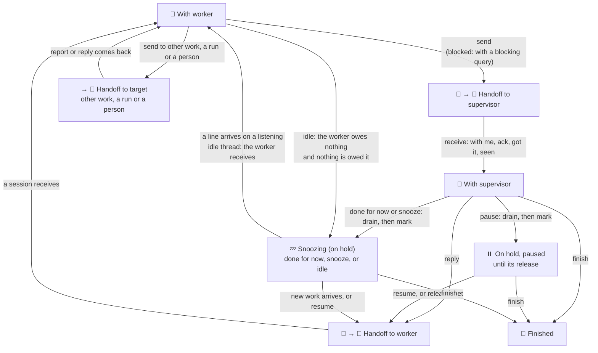

# Enactment draft: hold states and values in the Work Process note

Draft for the coordinator to route to Knowledge Islands Principal. It is not a record and edits no note. It carries two decisions Kris took on 7 November 2026 in the guilds interactive pass: HOLD-STATES a), whose Work Process note changes go "under one Enactment record", and VALUES-HOME a), "Write them once in the Work Process note under an Enactment record, and give each `work.md` an optional one-line `## Values` section linking them and adding any of its own." The harness side landed in ki-agentic-harness under `ki-coordination` [Putting work on hold](/Users/krisbrown/kis/knowledge-islands/ki-agentic-harness/skills/change-management/ki-coordination/references/standards-coordination.md#putting-work-on-hold) and `ki-work-package` [Work file](/Users/krisbrown/kis/knowledge-islands/ki-agentic-harness/skills/governance/ki-work-package/references/standards-work-package.md#work-file); the note should follow it word for word where they overlap.

## Proposed record

- **Title:** Hold states and values
- **Kind and purpose:** deliver, corrective
- **Goal:** the [Work Process](</Users/krisbrown/kis/knowledge-islands/ki-principal/Pillars/Philosophy/Model/Processes/Work Process/Work Process.md>) note draws the seven states as a flow, says what each hold reason lets through and who may set it, and holds the shared values once.
- **Context:** HOLD-STATES a) and VALUES-HOME a), Kris, 7 November 2026, from the design notes [hold-states.design.md](hold-states.design.md) and [how-we-work.design.md](how-we-work.design.md). SNOOZE, SNOOZE-STATE and SNOOZE-HEADING of 6 November 2026 already renamed "more expected" to Snoozing in the note.
- **Boundary:** the note's The seven states and a new Values section only. No change to levels, roles, homes or the banner section beyond the Snoozing heading's idle form.
- **Steps:** the four text changes below, then the note's diagram check.

## Text changes

### 1. The seven states table

The On hold row reads:

| Kind | State | When | Whose move |
| --- | --- | --- | --- |
| on hold | On hold, paused or snoozing | agreed and drained, or the worker's own idle hold: nothing running, queued or in handoff | nobody until its release |

The sentence under the table reads: "Only the supervisor's receive and the hold are set, besides the worker's own idle hold; every other state is derived from where the work's items lie."

### 2. On hold paragraph

After the snoozing bullet, add:

> - **idle**, a snoozing hold the worker sets itself, shown `💤 Snoozing (on hold) · idle`: the worker may rest its work by itself only when no run is running or queued, nothing is handed off, no message is unread, no query is with the supervisor and everything is pushed. It needs no drain and no hold report, and the supervisor's `pause`, `done for now` or `snooze` turns it into the supervisor's form.

Change "A hold is agreed only from With supervisor" to "A hold is agreed only from With supervisor, the idle hold aside".

After the drain sentences, add:

> A paused hold stays closed to every line, important and urgent ones included: State of play shows the count and puts an important line to the supervisor as a `resume` question, and genuinely urgent work goes to a live owner instead. Before any hold the work folder keeps nothing already dealt with.

In **Stuck and the heartbeat**, change "and stops listening while it drains and On hold" to "and stops listening while it drains and while paused; a snoozing hold, the idle hold included, keeps listening where the thread's listening is switched on".

### 3. State flow, under the table

Add the flow as Mermaid, with the plain-text version beside it, as HOLD-DIAGRAM a) chose: "Mermaid, a diagram written as text, in the Work Process note under The seven states, with a plain-text version beside it". Drain is an activity inside With worker, never a state.

Plain-text version:

- With worker sends to Handoff to supervisor, blocked when it carries a blocking query, or to Handoff to a target; a target's report or reply brings it back to With worker.
- Handoff to supervisor becomes With supervisor at the supervisor's receive; the supervisor's reply makes it Handoff to worker; a session's receive makes it With worker.
- From With supervisor: `pause` drains to On hold, paused; `done for now` or `snooze` drains to Snoozing; `finish` closes it.
- With worker may go idle, Snoozing set by the worker, when it owes nothing and nothing is owed it.
- Paused leaves at `resume` or its release; Snoozing at new work or `resume`; both to Handoff to worker, or to Finished on `finish`. A line arriving on a listening idle thread brings it straight back to With worker. An important line for paused work goes to the supervisor as a `resume` question, the work staying paused until answered.

### 4. Values

Add a `## Values` section after Overview:

> The work model holds five values, which every work package may link from an optional one-line `## Values` section in its `work.md`, adding any it holds itself: start finishing, stop starting · deliver often and as soon as ready · you build it, you run it · continual improvement · cross-functional work. Kris adopted them from Humans not Robots' development process on 3 November 2026 under VALUES-UP-FRONT, and set their home here under VALUES-HOME on 7 November 2026.

## Exception recorded

`personal.reg.household-terra` set its own hold at 23:50 GMT on 3 November 2026 after a `mark`, which the note did not then allow. Under HOLD-TERRA a) it was left as it stood and is re-recorded as an idle hold, `hold.set_by: worker`, once the refresh line reaches it, or put back to With supervisor if it no longer meets the five idle conditions.
