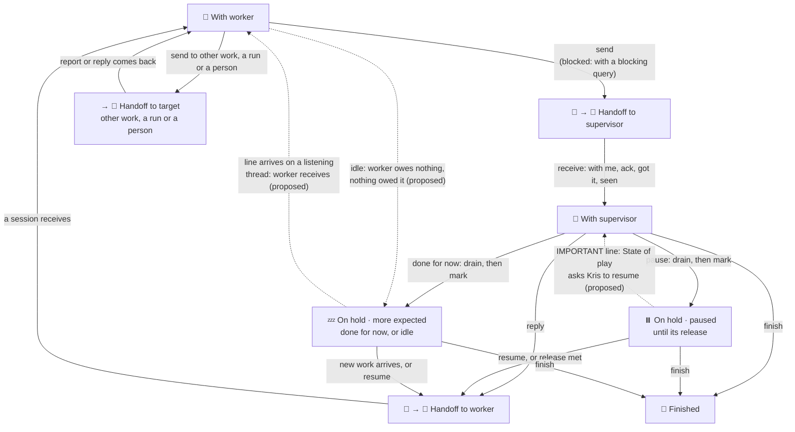

# Hold states: design note

Design note for [ki.sop.main](/Users/krisbrown/kis/knowledge-islands/ki-principal/+/_WORK/ki.sop.main/work.md), focus `_emerging`, under the `ki-work-design` method. It answers HOLD-STATES, Kris's request relayed by `personal.reg.household-terra` on the morning of 4 November 2026 (ki-principal `2208ed0a`): open an entry on how the work process itself looks, the seven states and the flow between them, with the On hold reasons documented well, "thought through" with Kris "before changes go out". It reads the method as it stands at ki-principal `2208ed0a` and ki-agentic-harness `2ce5e134`: the [Work Process](</Users/krisbrown/kis/knowledge-islands/ki-principal/Pillars/Philosophy/Model/Processes/Work Process/Work Process.md>) note, [standards-coordination.md](/Users/krisbrown/kis/knowledge-islands/ki-agentic-harness/skills/change-management/ki-coordination/references/standards-coordination.md) and [standards-work-package.md](/Users/krisbrown/kis/knowledge-islands/ki-agentic-harness/skills/governance/ki-work-package/references/standards-work-package.md).

Status: draft, brief and proposed-model stage. No independent review has run; the method's next step is at least two blind reviews before the merged report and before the decisions below reach Kris as settled options. This note edits no standard, note or footer.

## Summary

The seven states stand, but the model has one gap and one clash. The gap: On hold's two reasons, `paused` and `more expected`, are written as one undifferentiated state, so a banner says only `⏸️ On hold` and a reader cannot tell a stopped package from one resting with its door open. The clash: a package with nothing in hand, the idle case Kris agrees is a subcategory of On hold, has no lawful way in, because a hold is agreed only from With supervisor on Kris's `pause` or `done for now`; `personal.reg.household-terra` took that way in by itself at 23:50 GMT on 3 November. The proposal keeps two reasons, makes idle a worker-set form of more expected with strict entry conditions, lets more expected listen and paused not, gives each reason its own glyph in the heading, and adds a process-flow diagram of the states and moves to the Work Process note beside `work-model.svg`.

## Units of comprehension

| Unit | Boundary | Hand-offs |
| --- | --- | --- |
| State flow | Work Process note, The seven states: the states and the moves between them, drawn as a flow | Read by every standard that cites the note |
| Hold reasons | Work Process note, On hold paragraph; `ki-work-package` state file `hold` mapping | Read by the banner, the views and the Observatory |
| Hold entry and release | `ki-coordination` Putting work on hold | Uses the hold reasons; writes `state.md` |
| Listening while held | `ki-coordination` Inbox watch and mode lines | Reads `hold.reason` |
| Hold footer | Banner heading and mode lines: state words in `ki-coordination`, footer content `ki.prj.agora`'s under FOOTER-AGORA | Agora renders what the state words name |

## Already decided by Kris

- **Four kinds of state** - Work Process note: "It's either with someone or it's been handed off to someone or we've agreed effectively that it's like on hold ... or we can say it's done, at which point that area is concluded."
- **A mark is not a hold** - 15 October 2026: "a Mark is point in time and Hold / Drain is Mark + stopping all work", and "hold is a better word than drain. And what happens when you go on hold is that you drain any work ongoing by not restarting any."
- **Hold agreed by the supervisor** - Work Process note: a hold is agreed only from With supervisor, on `pause` or `done for now`; a worker may propose one in its send. "Putting work on hold and taking it off are agreed rather than sent."
- **Two reasons** - Work Process note: `paused`, with a named release; `more expected`, released by new work arriving. Regular work rests in more expected between occurrences.
- **Held paused work is not woken** - Work Process note, Held work keeps its hold: "A line routed to work On hold, paused, waits in its messages without waking it, and State of play shows the count." Refresh lines also wait.
- **No listening on hold** - LISTEN-STATUS, 31 October 2026: an open thread listens whoever holds the work, and "stops listening while it drains and On hold".
- **Listening is opt-in** - LISTEN-OPT-IN, 31 October 2026: "any of the coordination [threads] can be set up in this mode, but we've got to expressly ask them to be".
- **Banner layout** - FOOTER-LAYOUT, 31 October 2026: the banner read from the bottom up, modes as their own lines below the list.
- **Footer content is Agora's** - FOOTER-AGORA, about 23:40 GMT on 3 November 2026: what the art and the footer lines carry is `ki.prj.agora`'s, liaising with `ki.sop.main` as keeper of the standard.
- **Urgent work goes to a live owner** - ROUTE-UP and HOW-WE-WORK (1), 3 November 2026, carried in the [how-we-work design note](how-we-work.design.md): urgent work goes straight to the live leader on the escalation path, "Jimmy is not in, so Bobby". That note is itself still a draft.
- **This request** - HOLD-STATES, 4 November 2026, relayed: "On hold" reads as stopped, yet a package resting with nothing in hand still receives and acts on work, urgent messages included; the idle case is a subcategory of On hold; Kris wants the states as a flow diagram and each hold reason documented with what it lets through, who may set it and how it reads in the footer, for example `💤 On hold · more expected · listening` against `⏸️ On hold · paused until <release>`.

## Facts established

1. The seven states, their moves and the hold are written in prose and one table in the Work Process note; `work-model.svg` draws levels, forms and parties, not transitions. No flow diagram of the states exists anywhere in the method.
2. The note's other-headings list already names `⏸️ On hold · more expected`, but the `ki-coordination` Banner rule sets the settled heading to `⏸️ On hold` alone and its example writes the paused release in the heading (`⏸️ On hold · paused until the harness migration lands`). So the reason shows for paused and is optional for more expected.
3. The state file already records the reason: `hold.reason` is `paused` or `more-expected` and `hold.release` the condition in words (`ki-work-package` state fields). The Observatory reads both. Nothing records who set the hold.
4. The first-message exception already creates a package directly On hold, paused, `hold.release: when Kris opens this Project work`, with no Kris word: the method has one hold no supervisor agreed.
5. **household-terra, 3-4 November.** At 23:50 GMT on 3 November, `personal.reg.household-terra` took a mark at Kris's word and logged "Mark moved to now and processed clean: nothing since it, holding." In the same commit (chezmoi `2a0f878`, subject "takes a mark") it set `state: on-hold` from `with-supervisor`, with no hold mapping. At 00:11 GMT (chezmoi `4718188`) it added `hold.reason: more-expected` and a release of "a message arrives, Kris asks for work, or ki.sop.main announces the footer standard change". It kept `listening_status: on` while on hold. Kris said `mark`, not `pause` or `done for now`; no drain or hold report was given. Three rules were broken: the hold was not agreed, a mark was read as a hold, and the thread listened while held.
6. The thread's move was nonetheless what Kris wants a resting package to be: nothing in hand, door open, acting on what arrives. The rule, not the behaviour, is what does not fit.

## Reflection

1. On hold is one state with two meanings that differ in exactly the dimension a reader cares about: will this package act if I send it something? Paused: no. More expected: yes, that is its release. The heading must therefore always carry the reason.
2. Idle is more expected that the worker reached by itself. It differs from Kris's `done for now` only in who set it, not in behaviour: both rest, both listen if the thread may, both are released by new work. A third reason would add a word without a difference in behaviour; recording the setter is enough.
3. A worker may enter idle only when it owes nothing and is owed nothing it could chase: no run running or queued, nothing in handoff, no unprocessed message, no open query with Kris, and everything committed and pushed. If any query is with Kris, the work is With supervisor, not idle, and is shown so. This is what keeps idle from hiding work.
4. Paused stays closed. An IMPORTANT line does not wake it; State of play shows the waiting count and, for an important line, raises it to Kris as a `resume` query. Urgent work that cannot wait goes to a live owner by the escalation rule, not into a paused package. This keeps "paused" meaning what Kris's `pause` meant.
5. LISTEN-STATUS's "stops listening while On hold" was written before idle; it should hold for paused and be lifted for more expected, including idle, on threads with listening enabled. Kris's own example, `💤 On hold · more expected · listening`, implies this.
6. Two glyphs: ⏸️ for paused, nobody moves until the release; 💤 for more expected, nobody moves until something arrives. Both keep the rule that the last heading glyph is whose move it is. The reason and release go in the heading; listening stays a mode line, as FOOTER-LAYOUT set it. Kris's example puts listening inline; that is a footer choice for Agora under FOOTER-AGORA.
7. Entering idle needs a commit and a short line, not a hold report: the hold report exists to show a drain, and idle has nothing to drain. Leaving idle is a receive by the worker when a line arrives, moving to With worker, not to Handoff to worker, because the worker is already there and listening.
8. The flow diagram belongs in the Work Process note under The seven states, as Mermaid with a text fallback, as the note already does for `work-model.svg`. The Mermaid source is the canonical drawing; no SVG is needed unless the note's renderers cannot show Mermaid.

## Proposed model

### State flow

Solid arrows are the moves the Work Process note allows today; dotted arrows are this note's proposal. The drain is an activity inside With worker, never a state.



Fallback, if the diagram does not render:

- With worker sends to Handoff to supervisor, blocked when it carries a blocking query, or to Handoff to a target; a target's report or reply brings it back to With worker.
- Handoff to supervisor becomes With supervisor at Kris's receive; Kris's reply makes it Handoff to worker; a session's receive makes it With worker.
- From With supervisor: `pause` drains to On hold, paused; `done for now` drains to On hold, more expected; `finish` closes it.
- Paused leaves at `resume` or its release; more expected at new work or `resume`; both to Handoff to worker, or to Finished on `finish`.
- Proposed: With worker may go idle, On hold, more expected, by itself when it owes nothing; a line arriving on a listening idle thread brings it straight back to With worker; an IMPORTANT line for paused work goes to Kris as a `resume` query, the package staying paused until Kris answers.

### Hold reasons

| | Paused | More expected, done for now | More expected, idle |
| --- | --- | --- | --- |
| Means | stopped while other work goes on, until a named release | done for now; new work releases it | resting with nothing in hand; new work releases it |
| Who sets it | Kris only, `pause` | Kris, `done for now`; a worker may propose it in its send | the worker itself, only when all idle conditions hold |
| Entry | drain, mark, hold report | drain, mark, hold report | commit `docs(work): <id> hold, idle` and one line; no drain, no hold report |
| Ordinary lines | wait unread; State of play shows the count | release it; the next session acts on them | release it; a listening thread acts at once |
| IMPORTANT lines | wait; State of play raises a `resume` query to Kris | release it, taken first | release it, taken first |
| Urgent work | escalates to a live owner past it | released and acted on if the thread is live; otherwise escalates | acted on at once if listening; otherwise escalates |
| Refresh lines | wait | wait; read at the next receive | read at the next receive |
| Listening | never | while `listening_enabled` | while `listening_enabled` |
| Release | `resume`, or its condition met | new work, or `resume` | new work, or `resume`; Kris's `pause` or `done for now` turns it into the other forms |
| 31-day flag | yes | no | no |
| State file | `hold.reason: paused`, `hold.release` | `hold.reason: more-expected`, `hold.set_by: owner` | `hold.reason: more-expected`, `hold.set_by: worker` |

Idle conditions, all of them: no run running or queued; nothing in handoff to a target; no unprocessed line in `messages.md`; no open query with Kris in `discussions.md`; every repository the work touched committed and pushed. Parked queries may stand.

### Footer

The state words are this standard's; how they are drawn is Agora's. Proposed heading and mode lines:

```markdown
### ⏸️ On hold · paused until the harness migration lands · since 00:10 BST

🔇 not listening

### 💤 On hold · more expected · since 23:50 GMT

👂 listening

### 💤 On hold · idle · since 23:50 GMT

👂 listening
```

The counts line stays `⏸️ drained · 🅿️ <n> queries parked` for paused and done for now, and reads `💤 resting · 🅿️ <n> queries parked` for idle. Kris's inline form, `💤 On hold · more expected · listening`, is the alternative in HOLD-FOOTER below.

## Rollout, once decided

1. ki-principal: one Enactment record under `ki-repo-kb-streams` for the Work Process note: the flow diagram and its fallback under The seven states, the hold-reasons table, and the Words and Held work paragraphs.
2. ki-agentic-harness: `ki-coordination` Putting work on hold (idle entry, IMPORTANT handling), Inbox watch (listening on more expected), Banner (glyph per reason); `ki-work-package` state fields (`hold.set_by`). A message line to the harness, not a record, under HANDOFF-AS-MESSAGE.
3. `ki.prj.agora`: one message line with the agreed state words for its footer, under FOOTER-AGORA.
4. `personal.reg.household-terra`: a refresh line once the standard lands, so its 23:50 hold is re-recorded as idle or reverted per HOLD-TERRA.

## Decisions needed

Every recommendation below is unreviewed: no blind review has run, so none is above medium confidence.

### HOLD-IDLE - What the idle case is

**Context:** Kris agrees that a package resting with nothing in hand is a kind of On hold. Today On hold has two reasons, paused and more expected, and only Kris can set either. Idle behaves exactly like more expected (it rests and is released by new work); it differs only in that the worker reaches it by itself.

**Query:** Should idle be recorded as more expected with a note of who set it, or as a third reason of its own?

**Options:**

a) (recommended, confidence medium - same behaviour, fewer words; unreviewed) Idle is more expected set by the worker, recorded `hold.set_by: worker`, shown as `💤 On hold · idle`; the reasons stay two.

b) Idle becomes a third reason, `hold.reason: idle`, beside paused and more expected.

c) Idle is not a hold: the work stays With supervisor and the banner adds a "resting" line.

### HOLD-SELF - Whether a worker may put its own work on hold

**Context:** The Work Process note lets only Kris agree a hold, from With supervisor. The first-message exception already creates packages On hold without Kris. household-terra went on hold by itself at 23:50 GMT on 3 November after a `mark`, which the note does not allow, and behaved as Kris wants a resting package to behave.

**Query:** May a worker put its own work into the idle hold, and if so under what conditions?

**Options:**

a) (recommended, confidence medium - makes the useful behaviour lawful while keeping paused Kris's; unreviewed) Yes, into idle only, when all five idle conditions hold; paused and done for now stay Kris's words.

b) No: a worker may only propose a hold in its send, and a resting package stays With supervisor until Kris says `done for now`.

### HOLD-URGENT - Whether a paused package acts on urgent lines

**Context:** Today a line routed to paused work waits unread and State of play shows the count; important lines wait too. Kris asks whether a paused package still acts on urgent lines. The draft how-we-work design sends urgent work to a live owner, or up to a live leader, rather than into a sleeping queue.

**Query:** What should happen when an IMPORTANT line lands on paused work?

**Options:**

a) (recommended, confidence medium - keeps "paused" meaning stopped and puts the choice with Kris; unreviewed) It waits; State of play raises it to Kris as a `resume` query, and genuinely urgent work escalates to a live owner instead.

b) An IMPORTANT line releases a paused hold by itself, moving the work to Handoff to worker.

c) The package handles IMPORTANT lines in place and stays paused.

### HOLD-LISTEN - Which holds listen

**Context:** Under LISTEN-STATUS on 31 October 2026 Kris set that a listening thread stops listening while On hold. Kris's example for this request, `💤 On hold · more expected · listening`, shows a held thread listening, and household-terra listened while held. More expected is released by new work, which a listening thread can catch at once.

**Query:** Should more expected, including idle, keep listening on threads with listening enabled?

**Options:**

a) (recommended, confidence medium - follows Kris's own example and the release rule; unreviewed) Yes for more expected and idle; paused never listens. This revisits LISTEN-STATUS for more expected only.

b) Keep LISTEN-STATUS as it is: nothing On hold listens, and new work is found when a session next opens the work.

### HOLD-FOOTER - How each hold reads in the footer

**Context:** The banner heading today is `⏸️ On hold` for both reasons, with the paused release sometimes written in. Kris's examples are `💤 On hold · more expected · listening` and `⏸️ On hold · paused until <release>`. FOOTER-LAYOUT put modes such as listening on their own lines; FOOTER-AGORA gives the footer's content to `ki.prj.agora`, with `ki.sop.main` keeping the state words.

**Query:** How should the hold heading carry the reason and listening?

**Options:**

a) (recommended, confidence medium - keeps the agreed layout and the whose-move glyph rule; unreviewed) ⏸️ for paused and 💤 for more expected and idle, the reason and any release always in the heading, listening on its own mode line; send the words to Agora to draw.

b) As Kris's example: the reason and listening both inline in the heading, `💤 On hold · more expected · listening`, with no separate mode line on a held banner.

### HOLD-DIAGRAM - Where the flow diagram lives

**Context:** `work-model.svg` in the Work Process note draws structure, not transitions. Kris asks to see the states as a flow. The method allows inline text diagrams in design notes and committed SVGs under `ki-diagrams`.

**Query:** Where and in what form should the state-flow diagram go?

**Options:**

a) (recommended, confidence medium - one source, readable in Git and Obsidian, with a fallback as the note already does; unreviewed) Mermaid in the Work Process note under The seven states, with a text fallback, through one Enactment record.

b) An Archify SVG under `ki-diagrams`, committed beside `work-model.svg`.

### HOLD-TERRA - What to do with household-terra's hold now

**Context:** household-terra is On hold, more expected, since 23:50 GMT on 3 November, set by itself after a `mark`, listening. Under today's note that hold is not allowed; under this proposal it would be a lawful idle hold.

**Query:** Should household-terra's state be corrected now or left until the decisions land?

**Options:**

a) (recommended, confidence medium - avoids churn for a state the proposal makes lawful; unreviewed) Leave it, record the deviation here, and send it a refresh line once the standard changes, re-recording it as idle or reverting it as decided.

b) Revert it now to With supervisor and stop its listening while the design is decided.
