# Diagrams

This repository explains itself in a maintained set of Archify diagrams. Each answers one question, is traced from named source files, and is listed with its staleness trigger and regeneration prompt in [`diagrams.toml`](diagrams.toml). Each figure links to its interactive viewer, with search, focus, zoom and source links; `bun run self:diagrams:html` rebuilds every viewer locally.

## Skill map

What skills does the harness hold, in which source concern does each live, which functional areas does each serve, and what shape is each? The map is generated from the `skills/<concern>/<skill>/` layout, every `SKILL.md`'s `ki-kind` and `ki-applicability` frontmatter and the functional-area table by `ki-repo-harness`. Each outer region is one source concern, the folder a skill lives in. The functional areas are overlaid on it: where a concern's skills have different home areas, nested regions name each skill's home area and group, and every sublabel names each area the skill serves before the word saying when it applies. Colour says the same: governance that is always on in every repository, automatic where its structure is found, or opt-in once `.ki.toml` declares it, and a process that is a command you run by name. The map is the index to the functional-area diagrams below.

## Functional areas

Each functional-area diagram answers, for one area: which outside skills do its skills rely on, which outside skills rely on them, and how do they rely on each other? An area gathers the skills that serve one function, read from what each skill does and the declared edges between them, wherever its folder is; every skill is in at least one area, and a few serve two. They are generated from every `SKILL.md`'s `ki-depends-on` and `ki-optional-depends-on` frontmatter by `ki-repo-harness`, so they cannot drift from the declarations. The area's skills sit in the middle region, nested by capability group where the area is split; the outside skills they rely on are grouped by home area and group below it, and the outside skills that rely on them are grouped the same way above it. A skill drawn in an area that is not its home shows only its edges within that area; its home area's diagram draws the rest. A solid arrow is composition, a dashed arrow is optional augmentation, and every arrow runs downward from a skill to the skill it relies on. Nodes share the skill map's colours and name their source concern.

### Fundamentals

### Records and code

### Coordination

### Work and delivery

### Repository types

### Agentic systems

### Environment

### Acquire

### Signals

### Design

## Thread model

What steps does a piece of owner-directed work take? A coordinating thread under `ki-coordination` logs the owner's decision in their words, updates its checkpoint and writes a brief under `ki-delegation`; `ki agent` launches a detached agent, which does the work under `ki-git`, moves its work record, and ends with an owner report and `DONE`. The thread answers with a Summary and a reply block, and at each mark classifies its decisions into durable homes and tidies its folder until Project close. The diagram is traced from the two standards and cites the heading each step comes from.

