# Diagrams

This repository explains itself in a maintained set of Archify diagrams. Each answers one question, is traced from named source files, and is listed with its staleness trigger and regeneration prompt in [`diagrams.toml`](diagrams.toml). Each figure links to its interactive viewer, with search, focus, zoom and source links; `bun run self:diagrams:html` rebuilds every viewer locally.

## Skill map

What skills does the harness hold, in which source concern does each live, and what shape is each? The map is generated from the `skills/<concern>/<skill>/` layout and every `SKILL.md`'s `ki-kind` and `ki-applicability` frontmatter by `ki-repo-harness`. Each outer region is one concern, and the regions nested in a larger concern group its skills by the capability they bring. Colour and sublabel say when a skill applies: governance that is always on in every repository, automatic where its structure is found, or opt-in once `.ki.toml` declares it, and a process that is a command you run by name. The map is the index to the area diagrams below, one per concern.

## Skill areas

Each area diagram answers, for one concern: which outside skills do its skills rely on, which outside skills rely on them, and how do they rely on each other? They are generated from every `SKILL.md`'s `ki-depends-on` and `ki-optional-depends-on` frontmatter by `ki-repo-harness`, so they cannot drift from the declarations. The concern's skills sit in the middle region, nested by capability group where the concern is split; the outside skills they rely on are grouped by concern and capability group below it, and the outside skills that rely on them are grouped the same way above it. A solid arrow is composition, a dashed arrow is optional augmentation, and every arrow runs downward from a skill to the skill it relies on. Nodes share the skill map's colours and name their concern.

### Keystone

### Governance

### Change Management

### Repo Structure

### Agentic Systems

### Environment

### Acquire

### Design

## Thread model

What steps does a piece of owner-directed work take? A coordinating thread under `ki-pmo` logs the owner's decision in their words, updates its checkpoint and writes a brief under `ki-delegation`; `ki agent` launches a detached agent, which does the work under `ki-git`, moves its work record, and ends with an owner report and `DONE`. The thread answers with a Summary and a reply block, and at each mark classifies its decisions into durable homes and tidies its folder until Project close. The diagram is traced from the two standards and cites the heading each step comes from.

